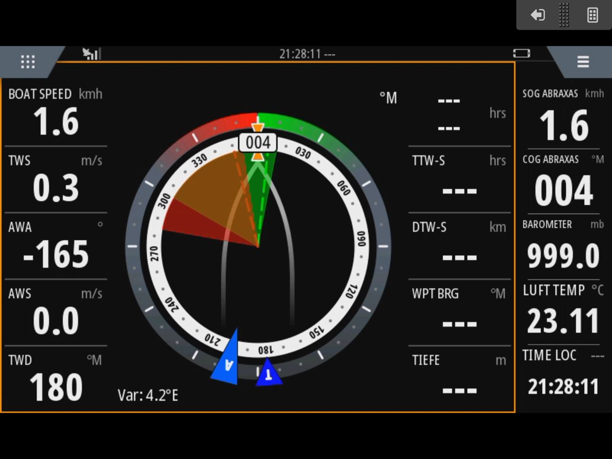

# Temperature, pressure and wind Data > NMEA2000

## Description
This repository shows how to measure the 
- temperature
- barometric pressure
- Windspeed
- Winddirection

and send it as NNMEA2000 meassage.
- PGN 130306 // Wind
- PGN 130314 // Pressure
- PGN 130316 // Temperature 

In addition, all data and a part of the configuration are displayed as a website.
The environmental sensor is automatically detected (i2c Adress and register) and selected.
No sensor is detected (but i2c Adress ist detected) this can be set in the setting.
The connection parameters to the wind sensor can also be set in the setting site.

## Based on the work of

Idea and basics for this Pojekt is "NMEA2000-TempPressure" from [@AK-Homberger](https://github.com/AK-Homberger).

This repository shows how to measure  and  with a BMP280 or BMP388 sensor and send it to NMEA2000 network.
Additional work a Gateway with inputs NMEA0183 TCP-Stream from my Windsensor "NoWa" or "Yachta" [@norbert-walter](https://github.com/norbert-walter) and send to NMEA2000.

The project requires the NMEA2000 and the NMEA2000_esp32 libraries from Timo Lappalainen: https://github.com/ttlappalainen. 

This project is part of [OpenBoatProject](https://open-boat-projects.org/)

## TPW Sensor Modul

For the BMP 280, BME280 or BMP388 the Adafruit BMP280, BME280 and BMP3xx library has to be installed via the library manager.
For HTML-Files use LittleFS Filesystem, you find her in /data directory.

The ESP32 in this project is an Adafruit Huzzah! ESP32. This is a small module without USB connector. You need CP2102 Connection Modul for programming.
For the ESP32 CAN bus, i used the SN65HVD230 chip as transceiver. The correct GPIO ports are defined in the main sketch. For this project, I use the pins GPIO4 for CAN RX and GPIO5 for CAN TX.
The 12 Volt is reduced to 5 Volt with a DC Step-Down_Converter. 12V DC comes from the N2k Bus Connector with the M12 Connector.
Its the same wiring and PCB with BD Sensor, you can leave out unnecessary components.

## Wiring diagram

## PCB

Aisler PCB Layout [link](https://aisler.net/p/NZFHAMAJ)

## Hardware

## Partlist:

- C1	C10µ	~	Capacitor_Tantalum_SMD
- C2	C22µ	~	Capacitor_Tantalum_SMD
- D1	P4SMAJ26CA
- D2	B360 [Link](https://www.reichelt.de/schottkydiode-60-v-3-a-do-214ab-smc-b-360-f-p95202.html?&trstct=pos_1&nbc=1)
- D3  PRTR5V0U2X
- D4	PESD1CAN	[Link](https://www.reichelt.de/can-bus-esd-schutzdiode-tvs-24-v-sot-23-3-pesd-1can-p219293.html?&trstct=pos_0&nbc=1)
- D5	LED_RBKG	[Link](https://www.reichelt.de/led-5-mm-bedrahtet-4-pin-rot-gruen-blau-700-1300-300-mcd-60-kbt-l-154a4surkq-p231040.html?&trstct=pol_0&nbc=1)
- FL1	EPCO B82789C0513 [Link](https://www.reichelt.de/smd-power-induktivitaet-1812-51-h-epco-b82789c0513-p245680.html?&trstct=pos_0&nbc=1)
- J1	Conn_01x04_Socket
- J2,J3	Conn_01x04_Pin	
- N1	Housing	Wago 789-120 [Link](https://www.wago.com/de/zubehoer/gehaeuse-55-mm/p/789-120)
- R1	300R	
- R2	10k	
- U1	TSR_1-2450	[Link](https://www.reichelt.de/dc-dc-wandler-tsr-1-1-w-5-v-1000-ma-sil-to-220-tsr-1-2450-p116850.html?search=tsr+1-24)
- U2	ESP32-Huzzah	[Link](https://www.exp-tech.de/plattformen/internet-of-things-iot/9350/adafruit-huzzah32-esp32-breakout-board)
- U3	SN65HVD230	[Link](https://www.reichelt.de/high-speed-can-transceiver-1-mbit-s-3-3-v-so-8-sn-65hvd230d-p58427.html?&trstct=pos_0&nbc=1)
- U4	BMP388	[Link](https://www.bluedot.space/products/bmp388/) (or BMP280 or BME280)

## Website

## Plotter

## Versions

- 2.6 Add BME280 and autoload the correct sensor setup, update website 
- 2.5 Minor update and add website details
- 2.4 Update windvalues and add windsensortemp for N2k, website cosmetic
- 2.3 Update windvalues for N2k
- 2.2 Update read values from windsensor, Update PCB
- 2.1 Update website Gauge's
- 2.0 Complete Website update, Windsensor Stream read update (code and html files)
- 1.3 Update windsensor Wlan connect code
- 1.2 Update website
- 1.1 Update PCB
- 1.0 working Version
